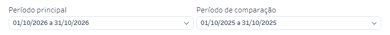
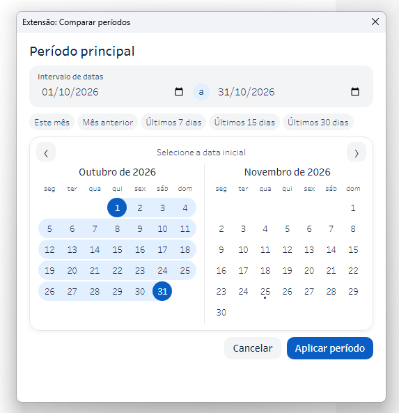
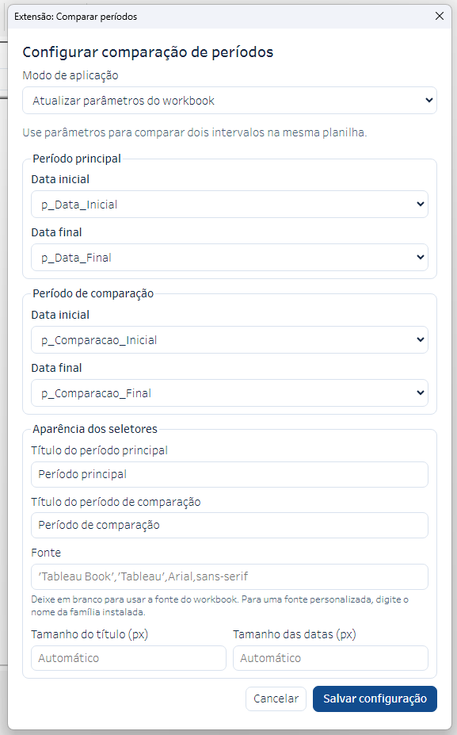

# Comparar períodos no Tableau

Extensão de dashboard que permite selecionar dois intervalos de datas independentes
e comparar indicadores no Tableau Desktop ou no Tableau Cloud.

- Seletor de intervalo em calendário com dois meses e atalhos de 7, 15 e 30 dias.
- Layout responsivo para cabeçalhos e barras laterais.
- Títulos, fonte e tamanhos configuráveis.
- Aplicação por planilha com filtros de intervalo existentes ou por parâmetros
  para comparar duas medidas na mesma planilha.

## Como usar a extensão

### 1. Escolha os períodos no dashboard



Clique na seta de **Período principal** para definir o intervalo que você quer
analisar. Depois, use **Período de comparação** para escolher a referência.
No exemplo, outubro de 2026 é comparado com outubro de 2025. Cada seletor
exibe o intervalo aplicado e pode ser alterado separadamente.

### 2. Selecione as datas no calendário



- Digite as datas no campo **Intervalo de datas** ou clique no primeiro e
  no último dia no calendário. O azul mais escuro marca as duas pontas e
  o azul-claro marca os dias entre elas.
- Use as setas para navegar mês a mês. Dois meses ficam visíveis ao mesmo
  tempo, o que facilita escolher um intervalo que cruza o fim do mês.
- Os atalhos **Este mês**, **Mês anterior** e **Últimos 7, 15 ou 30 dias**
  preenchem o intervalo automaticamente. Os atalhos de 7, 15 e 30 dias incluem hoje.
- Clique em **Aplicar período** para atualizar o painel ou em **Cancelar**
  para fechar a janela sem aplicar a seleção.

### 3. Configure os parâmetros e a aparência



Abra **Configurar** no menu do objeto da extensão. No modo **Atualizar parâmetros
do workbook**, associe quatro parâmetros do tipo **Data** aos dois seletores.

| Seletor | Data inicial | Data final |
| --- | --- | --- |
| Período principal | `p_Data_Inicial` | `p_Data_Final` |
| Período de comparação | `p_Comparacao_Inicial` | `p_Comparacao_Final` |

Esse modo permite comparar duas medidas na mesma planilha. Para direcionar
cada período a filtros de planilhas, use o modo **Filtros por planilha**
descrito na instalação abaixo.

Em **Aparência dos seletores**, ajuste os dois títulos e os tamanhos da fonte
dos títulos e das datas. Deixe **Fonte** em branco para usar a fonte do
workbook ou informe o nome de uma família instalada. Clique em
**Salvar configuração** e salve a pasta de trabalho.

## Testar no Tableau Desktop

Na raiz do projeto, rode o servidor local e mantenha o terminal aberto.

```powershell
py -m http.server 8765 --bind localhost --directory public
```

Em Linux ou macOS, use `python3` no lugar de `py`. Para testar só a interface,
abra a [prévia local](http://localhost:8765/comparar-periodos-0.4.html?preview=1).

No dashboard, arraste **Extensão** da seção **Objetos** e selecione
`comparar-periodos-0.4.trex` em **Acessar extensões locais**. Abra **Configurar**
no menu do objeto para escolher o modo de aplicação.

| Modo | Configuração |
| --- | --- |
| Filtros por planilha | Adicione o campo em **Filtros → Intervalo de datas** e escolha **Somente esta planilha**. Em **Configurar**, vincule a planilha e o campo ao período desejado. |
| Parâmetros do workbook | Escolha quatro parâmetros de data. Veja os [cálculos de exemplo](PARAMETROS.md) para exibir os dois períodos na mesma planilha. |

## Publicar no Tableau Cloud

O projeto inclui um `Dockerfile` para servir a interface com Nginx e um manifesto
de exemplo para a URL HTTPS. Veja o [guia de implantação](DEPLOY.md) para usar
Dokploy e liberar a extensão no site do Tableau Cloud.

## SDK do Tableau

`public/tableau.extensions.js` é idêntico ao
[arquivo oficial publicado como 1.17.0](https://github.com/tableau/extensions-api/blob/738f6b89c705edd6da6f27a6854c0da2bbdfb830/lib/tableau.extensions.1.17.0.js).
O arquivo oficial informa internamente a versão `1.17.0-pre.8`.

SHA-256: `af10dc548b24592b08a23b21ce221aefb6b56c84f45617ad0338789be5e7c20f`.

O SDK inclui o pacote `uuid`, cuja versão exata não foi confirmada no bundle.
O [CVE-2026-41907](https://osv.dev/vulnerability/CVE-2026-41907) afeta versões
do pacote anteriores à 14.0.0 nas chamadas `v3`, `v5` e `v6` com buffer externo.
Na revisão do bundle, a única chamada encontrada foi `v4()` sem buffer.
Não foi identificado um caminho da extensão até as funções afetadas.
Um scanner ainda pode sinalizar a dependência embutida. O projeto acompanha
novas distribuições oficiais do SDK para reavaliar esse achado.
A revisão não encontrou uma ocorrência pública desse CVE no repositório oficial do Tableau.

O transporte do SDK envia mensagens para a janela pai com `targetOrigin: '*'`
e filtra as mensagens recebidas pela janela de origem (`event.source`).
No Nginx, o cabeçalho `frame-ancestors` limita quem pode incorporar a extensão.
Veja a diferença entre Nginx e GitHub Pages no [guia de implantação](DEPLOY.md#github-pages).

## Autor

Yuri Fernando dos Santos, [@fernandoyuri13](https://github.com/fernandoyuri13).

O JavaScript do Tableau é distribuído com a licença original em
[public/TABLEAU-LICENSE.txt](public/TABLEAU-LICENSE.txt).
